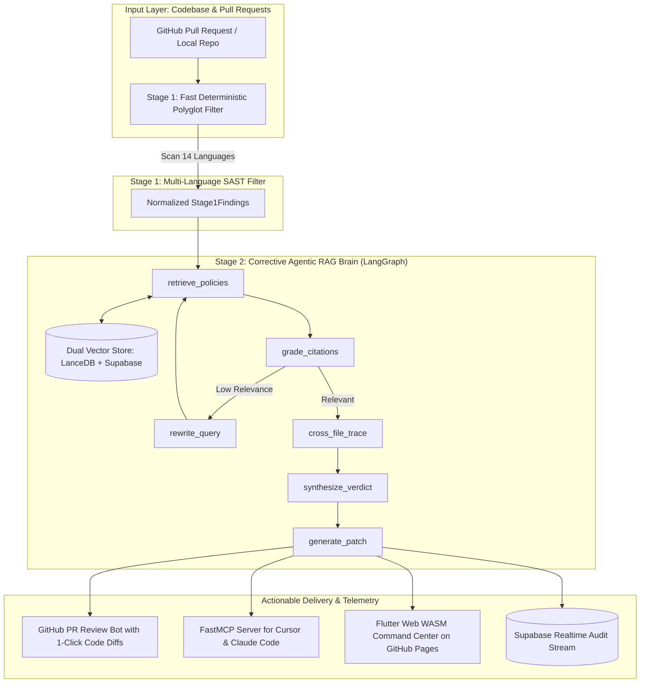

# 🛡️ Cortex-Compliance — Polyglot, Self-Healing Agentic RAG Compliance Engine

<p align="center">
  
  
  
  
  
  
</p>

---

## 📌 Executive Summary

**Cortex-Compliance** is an open-core, production-grade **Polyglot, Self-Healing Agentic RAG Compliance Platform**. It continuously audits source code across **14 programming languages** against major regulatory and security frameworks (**GDPR**, **OWASP Top 10**, **SOC 2 Type II**, **EU AI Act**, **HIPAA**, and **PCI-DSS v4.0**).

Unlike conventional SAST scanners that emit static noise, Cortex-Compliance implements a **Corrective Agentic RAG state machine in LangGraph**:
1. **Stage 1 (Fast Deterministic Filter)**: Instantly scans code in `<10ms` for syntactic attack sinks, leaked secrets, and regulatory red flags.
2. **Stage 2 (Agentic RAG & Auto-Patch)**: Queries dual-mode vector memory (**LanceDB** locally & **Supabase `pgvector`** in the cloud), grades legal citations, traces tainted variables across repository files, and synthesizes **1-click self-healing code diffs** ready to merge.
3. **Live Telemetry & WASM Dashboard**: Stream live audits via Supabase Realtime to a dark-mode **Flutter Web (WASM)** Command Center deployed to GitHub Pages.

---

## 🏗️ System Architecture



---

## 🌐 Polyglot Language Coverage (14 Languages)

Cortex-Compliance parses and secures modern polyglot technology stacks:

| Language | Target Vulnerabilities & Regulatory Violations | Compliance Standard |
| :--- | :--- | :--- |
| **Java** | Unparameterized JDBC `Statement.executeQuery`, `MessageDigest` (MD5/SHA1), `.properties` leaks | OWASP A03 / GDPR Art. 32 |
| **C# / .NET** | Unparameterized `SqlCommand`, `Process.Start` without `ArgumentList`, missing `[Authorize]` | OWASP A03 / SOC2 CC6.8 |
| **C / C++** | Deprecated buffer functions (`gets`, `strcpy`, `sprintf`), hardcoded credentials | CWE-120 / Memory Safety Mandate |
| **Rust** | Unguarded `unsafe` pointer dereferencing, unvalidated `.unwrap()` on input boundaries | SOC2 CC6.8 Software Integrity |
| **Go** | `fmt.Sprintf` dynamic SQL in `db.Query()`, silent error suppression (`_ = err`), MD5 crypto | OWASP A03 / CWE-89 |
| **Dart / Flutter** | Dynamic `GoogleFonts` runtime HTTP download, unencrypted `SharedPreferences` PII | GDPR Munich Court / CCPA |
| **Python** | Raw f-string SQL queries, `pickle.loads()`, `eval()`, hardcoded OpenAI/AWS secrets | OWASP A03 / CWE-89, CWE-95 |
| **TypeScript / JS** | DOM XSS via `innerHTML`, `document.write`, `eval()`, leaked GitHub/AWS tokens | OWASP A03 / CWE-79, CWE-798 |
| **Kotlin & Scala** | Slick string query interpolation (`sqlu"..."`), `sys.process`, unvalidated reflection | OWASP Top 10 A03 |
| **Ruby & PHP** | `User.where("#{params[:id]}")`, `mysqli_query` concatenation, unsanitized `$_GET`/`$_POST` | OWASP A03 / CWE-89 |
| **Swift** | Insecure `UserDefaults` credential storage, `NSTask` raw command invocation | OWASP Mobile Top 10 |
| **SQL / Migrations** | `DISABLE ROW LEVEL SECURITY`, public service role privileges | Supabase Security RLS Mandate |

---

## ⚖️ Supported Regulatory Frameworks

Markdown rulebooks stored under [`policies/`](policies/) define legal penalty frameworks:

* 🇪🇺 **GDPR (General Data Protection Regulation)**: Articles 6, 8, 17, 25, 44–49; Landgericht München dynamic font IP leak enforcement.
* 🛡️ **OWASP Top 10 (2021)**: A01 Broken Access, A02 Crypto Failures, A03 Injection, A07 Auth Failures.
* ☁️ **SOC 2 Type II**: Trust Services Criteria CC6.1 (Access Controls), CC6.6 (Boundary Protection), CC6.8 (Integrity & Malware), and CC7.1.
* 🤖 **EU AI Act**: Mandatory transparency, risk management systems, human oversight, and data governance for high-risk AI models.
* 👶 **FTC COPPA & Global Minor Privacy**: Neutral age gating, verifiable parental consent, and prohibition of child data profiling.
* 🔒 **Supabase RLS & Cloud Security**: Row Level Security enforcement, service_role key leak prevention, and secure tenant isolation.

---

## 🚀 Quick Start & Installation

### Option 1: Live Web Command Center (Zero Install)
Launch the dark-mode WASM-compiled SaaS Command Center hosted directly on GitHub Pages:
👉 **[Open Live Command Center](https://joelaah.github.io/compliance-checker/)**

---

### Option 2: Run via CLI (Python & Agentic RAG Engine)
Clone the repository and run the engine locally:

```bash
# Clone the repository
git clone https://github.com/joelaah/compliance-checker.git
cd compliance-checker

# Set up environment using uv (recommended) or standard venv
uv venv .venv
# Windows: .venv\Scripts\activate
# macOS/Linux: source .venv/bin/activate

# Install dependencies in editable mode
uv pip install -e ".[dev]"

# Run an automated compliance audit on any file or directory
python -m cortex_rag.compliance_agent src/
```

---

### Option 3: Run the Flutter Web Command Center Locally
To test or customize the WASM dashboard locally:

```bash
cd dashboard
flutter pub get
flutter run -d chrome
```

---

### Option 4: Classic Zero-Dependency Web UI (Single-File SAST)
To launch the original client-side 195-nation launch evaluation tool:

```bash
# Windows
start index.html

# macOS
open index.html

# Linux
xdg-open index.html
```

---

## 📂 Project Structure

```text
compliance-checker/
├── cortex_rag/                    # Polyglot Agentic RAG Brain (Python)
│   ├── config.py                  # Pydantic Settings (Ollama, Supabase, LanceDB)
│   ├── state.py                   # Strict Pydantic models (Findings, Citations, Verdicts, Patches)
│   ├── stage1_scanner.py          # Polyglot deterministic SAST scanner (14 languages)
│   ├── polyglot_chunker.py        # Syntax & comment-aware chunker for code and markdown
│   ├── hybrid_indexer.py          # Dual vector indexer (LanceDB Vector/BM25 & Supabase pgvector)
│   ├── compliance_agent.py        # LangGraph Corrective RAG state machine
│   ├── github_pr_bot.py           # PR review comments with 1-click mergeable unified diffs
│   └── mcp_server.py              # FastMCP server for Cursor and Claude Code integration
├── dashboard/                     # Flutter Web (WASM) SaaS Command Center
│   ├── lib/main.dart              # Dark-mode Cyber UI, KPI gauges, split diff & Realtime stream
│   ├── assets/latest_audit.json   # Zero-backend offline telemetry snapshot
│   └── web/index.html             # WASM web harness with base-href configuration
├── policies/                      # Markdown Regulatory Rulebooks
│   ├── gdpr_data_privacy.md       # GDPR articles, Munich font ruling, penalty matrix
│   ├── owasp_top_10.md            # OWASP Top 10 vulnerabilities & code patterns
│   ├── flutter_supabase_rules.md  # Supabase RLS and client-side credential rules
│   ├── eu_ai_act.md               # High-risk AI model requirements
│   └── soc2_type2.md              # Trust Services Criteria mappings
├── supabase/
│   └── schema.sql                 # pgvector (768), HNSW index, FTS, Realtime audit tables
├── .github/workflows/
│   ├── cortex-compliance.yml      # CI: Runs local Ollama Agentic RAG on PRs and commits LanceDB
│   └── deploy-flutter-ui.yml      # CD: Builds Flutter Web (--wasm) and deploys to GitHub Pages
├── tests/                         # Comprehensive Unit & Integration Test Suites
│   ├── test_stage1_polyglot.py    # 14-language vulnerability detection tests
│   ├── test_polyglot_chunker.py   # Syntax chunking & comment-stripping tests
│   └── test_cortex_engine.py      # LangGraph, LanceDB, PR bot, and MCP tool tests
├── app.js                         # Core client-side SAST rules (unmodified Stage 1 base)
├── index.html                     # Classic responsive HTML5 audit interface
├── styles.css                     # Dark cybersecurity design system
├── pyproject.toml                 # Modern Python packaging managed via uv
└── README.md                      # Platform documentation & architectural specifications
```

---

## 🧪 Verification & Test Suite

All components are accompanied by automated tests:

```bash
# 1. Run the Python Polyglot & Agentic RAG test suite (27 tests)
pytest tests -v

# 2. Run the original 195-nation sovereign engine verification
node verify_engine.js

# 3. Run Flutter dashboard widget tests & static analysis
cd dashboard
flutter test
flutter analyze
```

---

## 🤝 Model Context Protocol (MCP) Integration

Cortex-Compliance exposes a built-in FastMCP server so tools like **Cursor** and **Claude Code** can query compliance policies and verify patches in real-time:

```bash
# Start the MCP server
python -m cortex_rag.mcp_server
```

**Exposed MCP Tools:**
* `scan_compliance(file_path, code)`: Runs Stage 1 & Stage 2 verification on active editor buffers.
* `query_compliance_rules(query, limit)`: Performs semantic search over regulatory markdown rulebooks.
* `verify_patch_diff(file_path, diff)`: Validates that a generated diff eliminates the targeted vulnerability without introducing new flaws.
* `get_audit_history(limit)`: Retrieves previous compliance audit telemetry and health scores.

---

## 📄 License

This project is licensed under the [MIT License](LICENSE).
